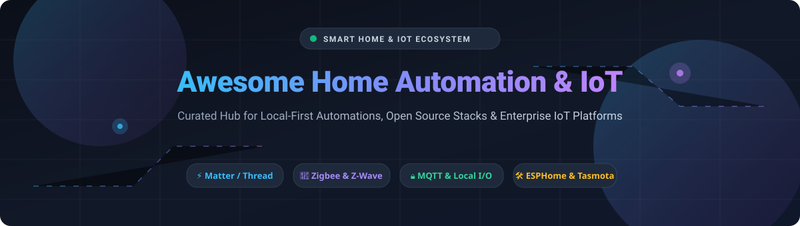

# Awesome-Home-Automation-IOT

# 🎬 Awesome 3D Graphics & WebGL

  

  
  
  
  
  
  

---

## 🚀 Top 3D Graphics & WebGL Ecosystem

**Curated List of SaaS Products & Open-Source GitHub Projects for 3D Developers, Game Engineers, Technical Artists & WebGL Architects**  
*Focused on Real-Time Rendering, WebGL Frameworks, Game Engines, 3D Modeling, Photorealistic Visualization & Interactive Experiences*  

📅 **Last updated:** October 2026

---

### 💡 Overview & SEO Keywords

This repository tracks notable **SaaS platforms** and **open-source projects** for **3D Graphics & WebGL**. In modern interactive media, 3D rendering and WebGL systems power everything from browser-based product configurators and architectural visualizations to AAA game production pipelines and real-time virtual production stages.

Key architectural concepts and search keywords covered include:
- **WebGL & WebGPU Rendering**: Browser-native 3D graphics via Three.js, Babylon.js, PlayCanvas, and low-level WebGL 2.0/WebGPU compute shaders.
- **Game Engines & Real-Time Rendering**: Godot, O3DE, Bevy, and proprietary engines (Unity, Unreal) for game development, simulation, and cinematic production.
- **3D Modeling & CAD**: Parametric modeling, mesh sculpting, procedural generation, and CAD kernels (FreeCAD, Blender, OpenSCAD).
- **Physically Based Rendering (PBR)**: Filament, bgfx, and glTF 2.0 workflows for photorealistic material authoring and cross-platform asset delivery.
- **Gaussian Splatting & NeRF**: Next-generation neural rendering and 3D reconstruction pipelines for real-time radiance field capture and playback.

---

## 📋 Table of Contents

- [📊 Sector Overview & Market Dynamics](#-sector-overview--market-dynamics)
- [☁️ SaaS/Hosted Platforms](#️-saashosted-platforms)
- [🔓 Open-Source GitHub Projects](#-open-source-github-projects)
- [🏗️ Architectural Guidelines & Pipelines](#️-architectural-guidelines--pipelines)
- [🤝 How to Contribute](#-how-to-contribute)
- [💖 Support & Community](#-support--community)
- [⚠️ Disclaimer](#️-disclaimer)
- [⭐ Star History](#-star-history)

---

## 📊 Sector Overview & Market Dynamics

> 📈 **Estimated Market Size & Sector Structure:** The global 3D rendering and visualization market is estimated at **~$5.23 Billion** in 2026, projected to reach **~$13.92 Billion by 2031** (CAGR ~21.6%). The sector exhibits a **moderately fragmented** structure: cloud hyperscalers and enterprise platforms (NVIDIA Omniverse, AWS) provide foundational GPU-accelerated simulation and collaboration infrastructure, while open-source engines (Godot, O3DE) and specialized SaaS providers (Sketchfab, Praxilla) capture developer and creator workloads through accessible tooling and cloud-native rendering pipelines. WebGL libraries like Three.js (112.8k stars) and Babylon.js (25.6k stars) dominate browser-based 3D delivery [citation:7][citation:6].

---

## ☁️ SaaS/Hosted Platforms

| Platform / Service | Company Size (Valuation / Revenue) ↓ | Pricing (Starting Tier) | Free Tier / Free Trial Limit | Key Focus & Capabilities |
| :--- | :--- | :--- | :--- | :--- |
| **[NVIDIA Omniverse](https://www.nvidia.com/en-us/omniverse/)** | **~$5 Trillion** Market Cap (First company to reach $5T; Data Center revenue driving growth) [citation:24][citation:31] | **$8,765.24/GPU/year** (Enterprise 1-year subscription) [citation:3] | **Free Individual tier** with core Omniverse Kit tools; **90-day Enterprise trial** for teams | Enterprise real-time 3D simulation and collaboration platform. USD-based workflow, PhysX simulation, RTX ray tracing, and OpenUSD pipeline integration for digital twins and virtual production. |
| **[Unity](https://unity.com/)** | **~$12.9 Billion** Market Cap (FY 2025 Revenue ~$1.8B; 71% of top 1,000 mobile games built on Unity) [citation:21][citation:10] | **$0** (Personal, revenue under $200k/yr) or **$2,200/year** (Pro, per seat) | **Free Personal tier** (no revenue cap for hobbyists); **30-day Pro trial** | Industry-leading cross-platform game engine and real-time 3D development platform. Dominates mobile, VR/AR, and indie game development with extensive Asset Store and Unity Cloud services. |
| **[Epic Games Unreal Engine](https://www.unrealengine.com/)** | **~$22.5 Billion** Valuation (Disney-backed; 2024 investment at $22.5B) [citation:22] | **Free** (with 5% royalty after $1M lifetime gross) | **Free** (no cost for learning, non-game, or under $1M revenue); **free educational licenses** | AAA-capable game engine and real-time visualization platform. Nanite virtualized geometry, Lumen global illumination, MetaHuman Creator, and virtual production tools used in 59% of Hollywood blockbusters [citation:10]. |
| **[Autodesk Maya](https://www.autodesk.com/products/maya/)** | **~$55 Billion** Market Cap (Autodesk; M&E division includes Maya, 3ds Max, Arnold) [citation:23] | **$225/user/month** (monthly) or **$1,785/year** (annual commitment) [citation:4] | **30-day free trial** with full feature access | Industry-standard 3D animation and VFX software. Arnold renderer, Bifrost procedural effects, XGen hair/fur, and MotionBuilder integration for character animation and film production [citation:13]. |
| **[Sketchfab](https://sketchfab.com/)** | **~$50 Million** Valuation (Acquired by Epic Games; profitable 3D asset marketplace) | **$79/month** (Premium, yearly billing) or **$129/month** (monthly) [citation:14] | **Free account** with unlimited public uploads and 10 private models; **Premium trial** available | Leading web-based 3D model viewer and marketplace. Instant WebGL embedding, VR viewing, glTF/USDZ streaming, and store integration for selling 3D assets. |
| **[Praxilla](https://praxilla.eu/)** | **~€5 Million** Valuation (Independent cloud rendering startup) | **€2.50/GPU hour** (Cycles and Eevee rendering for Blender) [citation:2][citation:20] | **Free trial credits** upon signup; files deleted immediately after render | GPU-accelerated cloud rendering specifically for Blender artists. No file retention, indie-friendly pricing, and support for both Cycles and Eevee rendering engines. |
| **[Blender Cloud](https://cloud.blender.org/)** | **~€5.7 Million** Annual Revenue (Blender Foundation; 2025 income grew 36%) [citation:32] | **$11.50/month** (automatic renewal) or **$119/year**; **$17/month** (manual) [citation:11] | **Free account** with access to some open projects; **subscription required** for full training and assets | Open production platform from the Blender Foundation. Access to all Open Movies, production assets, training DVDs, and Cloud subscription funding Blender development. |

---

## 🔓 Open-Source GitHub Projects

*Sorted by GitHub_Stars_Count (Descending)* ⭐

- **[Three.js](https://github.com/mrdoob/three.js)**   
  **JavaScript 3D Library**, MIT licensed. The most widely-used WebGL framework for creating 3D graphics in the browser. Features scene graph architecture, PBR materials, GLTF loaders, post-processing, and extensive examples. **Best for browser-based 3D experiences, data visualization, and product configurators** [citation:7].

- **[Godot Engine](https://github.com/godotengine/godot)**   
  **Multi-platform 2D and 3D game engine**, MIT licensed. Lightweight, fully open-source engine with Vulkan backend, C# support, and a visual shader editor. Captured 8% of game engine market in 2024 (140% increase since 2022) with backing from Microsoft and Intel [citation:10]. **Best for indie game development and lightweight 3D applications** [citation:7].

- **[Raylib](https://github.com/raysan5/raylib)**   
  **Simple and easy-to-use library for videogames programming**, Zlib licensed. C-based game development library with no external dependencies. Supports 3D rendering, audio, and input across desktop, web, and embedded platforms. **Best for learning game programming and rapid prototyping** [citation:7].

- **[FreeCAD](https://github.com/FreeCAD/FreeCAD)**   
  **Open-source parametric 3D modeler**, LGPL-2.0 licensed. Professional-grade CAD with Python scripting, constraint-based sketcher, and support for IFC, STEP, IGES, and STL formats. **Best for engineering design, architecture, and parametric modeling** [citation:7].

- **[React Three Fiber](https://github.com/pmndrs/react-three-fiber)**   
  **React renderer for Three.js**, MIT licensed. Declarative React components for Three.js scenes with automatic reconciliation, hooks, and ecosystem integration (Drei helpers). **Best for React developers building 3D web applications** [citation:7].

- **[Babylon.js](https://github.com/BabylonJS/Babylon.js)**   
  **Powerful web 3D engine**, Apache-2.0 licensed. Complete game engine for the web with built-in physics, node material editor, GUI system, and WebGPU support. **Best for complex WebGL games and enterprise 3D applications** [citation:7].

- **[LibGDX](https://github.com/libgdx/libgdx)**   
  **Desktop/Android/HTML5/iOS Java game development framework**, Apache-2.0 licensed. Cross-platform 2D/3D game development with OpenGL ES rendering, Box2D physics, and asset pipeline tools. **Best for Java game developers targeting multiple platforms** [citation:7].

- **[GDevelop](https://github.com/4ian/GDevelop)**   
  **Open-source, cross-platform game engine**, MIT licensed. No-code game creation with visual event system, 2D/3D support, and one-click export to web, desktop, and mobile. **Best for non-programmers and rapid game prototyping** [citation:7].

- **[3D Gaussian Splatting](https://github.com/graphdeco-inria/gaussian-splatting)**   
  **Original reference implementation of 3D Gaussian Splatting**, Custom license. Real-time radiance field rendering via differentiable Gaussian rasterization. **Best for next-gen 3D reconstruction and neural rendering research** [citation:7].

- **[Filament](https://github.com/google/filament)**   
  **Real-time physically based rendering engine**, Apache-2.0 licensed. Google's mobile-first PBR engine for Android, iOS, Windows, Linux, and WebGL. Minimal footprint with high-quality materials. **Best for mobile 3D applications and glTF-based product visualization** [citation:7].

- **[Instant NGP](https://github.com/NVlabs/instant-ngp)**   
  **Instant Neural Graphics Primitives**, MIT licensed. NVIDIA's fast NeRF implementation with multiresolution hash encoding. Trains neural radiance fields in seconds. **Best for real-time NeRF capture and neural rendering pipelines** [citation:7].

- **[Blender](https://github.com/blender/blender)**   
  **Free and open 3D creation suite**, GPL-3.0 licensed. Complete pipeline for modeling, rigging, animation, simulation, rendering, compositing, and video editing. 22+ million downloads in 2025 with 280+ active contributors [citation:32][citation:7]. **Best for full 3D production pipelines and open-source VFX**.

- **[A-Frame](https://github.com/aframevr/aframe)**   
  **Web framework for building virtual reality experiences**, MIT licensed. Declarative HTML-based VR development on top of Three.js with entity-component architecture. **Best for quick WebXR prototyping and VR web experiences** [citation:7].

- **[Marlin](https://github.com/MarlinFirmware/Marlin)**   
  **Firmware for RepRap 3D printers**, GPL-3.0 licensed. Optimized for 8-bit and 32-bit microcontrollers with support for 3D printing, laser engraving, and CNC. **Best for open-source 3D printing hardware control** [citation:7].

- **[bgfx](https://github.com/bkaradzic/bgfx)**   
  **Cross-platform rendering library**, BSD-2-Clause licensed. Backend-agnostic graphics API abstraction supporting Direct3D, Metal, OpenGL, Vulkan, and WebGL. **Best for multi-platform rendering layers and engine abstraction** [citation:7].

- **[Open 3D Engine (O3DE)](https://github.com/o3de/o3de)**   
  **AAA-capable open-source game engine**, Apache-2.0 licensed. Successor to Amazon Lumberyard, backed by Linux Foundation with partners including AWS, Adobe, Microsoft, and Intel [citation:27][citation:34]. **Best for AAA game development and simulation without licensing fees** [citation:7].

- **[glTF-Transform](https://github.com/donmccurdy/glTF-Transform)**   
  **glTF 2.0 SDK for JavaScript and TypeScript**, MIT licensed. Programmatic API for reading, editing, and optimizing glTF/GLB assets. Supports Draco compression, texture resizing, and format conversion. **Best for automated 3D asset pipeline optimization** [citation:9].

- **[Meshoptimizer](https://github.com/zeux/meshoptimizer)**   
  **Mesh optimization library**, MIT licensed. Algorithms for vertex cache optimization, overdraw reduction, mesh simplification, and vertex buffer compression. **Best for game asset pipeline optimization** [citation:7].

- **[GLTFLoader (Minimal)](https://github.com/shrekshao/minimal-gltf-loader)**   
  **Minimal, engine-agnostic JavaScript glTF Loader**, MIT licensed. Lightweight glTF 2.0 parser with no dependencies, designed for integration into custom WebGL engines. **Best for custom WebGL engine glTF support** [citation:18].

- **[OpenSCAD](https://github.com/openscad/openscad)**   
  **The Programmers Solid 3D CAD Modeller**, GPL-2.0 licensed. Script-based 3D modeling using a declarative language for parametric design and 3D printing. **Best for procedural CAD and parametric modeling** [citation:7].

- **[Assimp](https://github.com/assimp/assimp)**   
  **Open Asset Import Library**, BSD-3-Clause licensed. Cross-platform 3D model import/export supporting 40+ formats (FBX, OBJ, GLTF, DAE, STL, etc.). **Best for universal 3D asset pipeline integration** [citation:7].

- **[Cesium](https://github.com/CesiumGS/cesium)**   
  **Open-source JavaScript library for world-class 3D globes and maps**, Apache-2.0 licensed. WebGL-based geospatial visualization with terrain, 3D Tiles, and time-dynamic data support. **Best for GIS, geospatial 3D, and digital twin visualization** [citation:7].

---

## 🏗️ Architectural Guidelines & Pipelines

Building a scalable, production-ready 3D graphics and WebGL infrastructure typically follows a tiered architectural model:

1. **Asset Authoring & Optimization:**
   - Author models in **Blender**, **FreeCAD**, or **Autodesk Maya** using PBR workflows (metallic-roughness or specular-glossiness).
   - Export to **glTF 2.0** (`.glb`) using **glTF-Transform** or **Assimp** for cross-platform compatibility.
   - Apply **Draco** mesh compression and **KTX2/Basis Universal** texture compression for web delivery.
   - Run **Meshoptimizer** for vertex cache optimization and overdraw reduction before deployment.

2. **WebGL Rendering Layer:**
   - Choose a framework: **Three.js** for general-purpose 3D, **Babylon.js** for game-like interactivity, or **PlayCanvas** for collaborative editor workflows.
   - Implement **React Three Fiber** for React-based applications with declarative scene composition.
   - Use **WebGPU** where available (Chrome, Edge) for compute shader acceleration and lower CPU overhead.
   - Implement **Level of Detail (LOD)** systems and frustum culling for scene performance optimization.

3. **Real-Time Game Engine Pipelines:**
   - **Godot** or **O3DE** for full game production with Vulkan rendering backend.
   - Import glTF assets with **Godot's FBX2glTF** converter or native glTF support.
   - Configure **Forward+** or **Mobile** renderers based on target hardware (desktop vs. mobile/XR).
   - Use **GPU instancing** and **multimesh** for crowd/dense scene rendering.

4. **Neural Rendering & Gaussian Splatting:**
   - Capture multi-view imagery using photogrammetry or video sequences.
   - Train **3D Gaussian Splatting** models using the reference implementation (22.2k stars) for real-time radiance field rendering.
   - Export splat data to **SuperSplat** or custom WebGL viewers for browser-based playback.
   - Deploy **Instant NGP** for rapid NeRF iteration during capture planning.

5. **Deployment & Delivery:**
   - Bundle WebGL applications with **Vite** or **Webpack** for optimized production builds.
   - Deploy to **GitHub Pages**, **Vercel**, or **Netlify** with automatic CI/CD.
   - Serve glTF assets via **CDN** with gzip/brotli compression and proper MIME types (`model/gltf-binary`).
   - Implement **progressive loading** for large scenes: load low-LOD meshes first, then stream high-detail geometry.

---

## 🤝 How to Contribute

Contributions are warmly welcome! To contribute a new SaaS platform, open-source project, or architectural guideline:

1. 🔀 **Fork the repository**.
2. 📝 **Add your tool** under the appropriate section adhering to the established schema:
   - For SaaS: Include company size / valuation, specific starting price, specific free tier limits, and core features.
   - For Open-Source: Include the stargazer count badge ``, license, and "Best for" use-case. Maintain descending star order.
3. 🚀 **Submit a Pull Request (PR)** with a descriptive title and rationale.

Check out [Awesome Lists](https://github.com/ishandutta2007/Awesome-Awesome-Awesome) for wider community guidelines!

---

## 💖 Support & Community

Thank you for exploring **Awesome 3D Graphics & WebGL**! If you find this curated ecosystem helpful for your 3D projects, rendering pipelines, or WebGL applications:

- 🌟 **Star this repository** to help fellow engineers discover it.
- 🔀 **Fork and share** with colleagues, dev teams, and 3D artists.
- ☕ **Sponsor the project** or buy a coffee to support continuous updates and active curation:

  

---

## ⚠️ Disclaimer

- This is a **community-curated list** created strictly for educational, technical, and architectural reference.
- 3D graphics and WebGL development may involve patented codec or rendering techniques. Verify licensing requirements for commercial deployments.
- Performance evaluations should always be validated empirically across target hardware and browsers (WebGL 1.0/2.0/WebGPU) using representative production assets.

---

## ⭐ Star History

---

  <b>Made with ❤️ for 3D developers, game engineers, and WebGL architects.</b>

